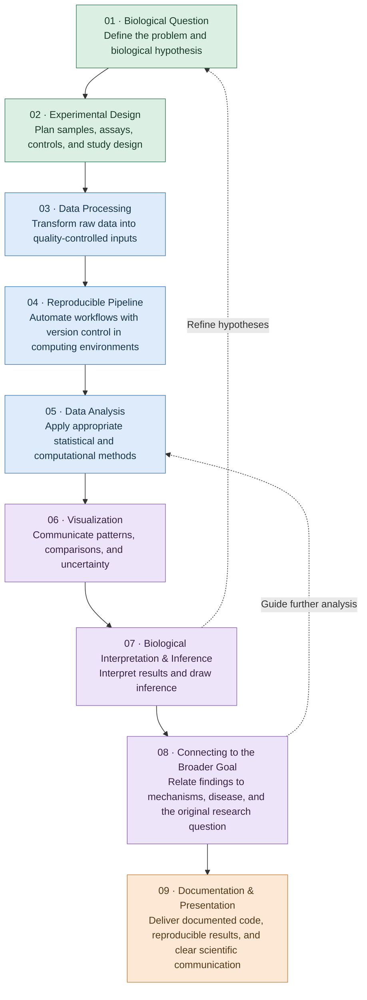

<!-- Typing SVG -->

  

## About Me

I am a Bioinformatics Professional with 4+ years of experience across genomics (ONT Long-read DNAseq), epigenetics (DNAm Array), transcriptomics (bulk RNAseq, single-cell/nucleus RNAseq), proteomics (global, phospho, co-IP) and multi-omic integration. I turn complex, high-dimensional biomedical data into biologically relevant actionable insights, drawing on my background in molecular biology to ask the right questions before reaching for the right method. For my data analysis, I build reproducible workflows in full adherence to FAIR data principles.

I bridge wet-lab and computational teams, and I have extensive experience in coordinating cross-functional collaborations. Passionate about disease mechanisms and therapeutic discovery, I am eager to apply my skills to solving real-world problems.

### Background
- 🎓 Ph.D., Medical Sciences, Lund University
- 🎓 M.Sc., Molecular Biology, Genetics and Biotechnology, Lund University
- 🎓 B.Tech., Biotechnology, SASTRA University
- 🧫 Other experience: Software Developer, TCS
- 📍 Lund, Sweden

### 🧰 Technical Toolkit

**Programming Languages**

**Workflow & Pipeline Development**

**High-Performance Computing & Containers**

**Version Control & Collaboration**

---

### 🔬 How I Work

### Featured Projects
| Project                                                                                                   | Description                                                                                                                                                                                | Featured                                                                              |
| --------------------------------------------------------------------------------------------------------- | ------------------------------------------------------------------------------------------------------------------------------------------------------------------------------------------ | ------------------------------------------------------------------------------------- |
| [**Long-read_SVA_Poly**](https://github.com/chanmur/Long-read_SVA_Poly)                                   | Nextflow pipeline for structural variant calling and SVA annotation in Oxford Nanopore long-read DNA sequencing data.                                                                               | Pilot                                                                                 |
| [**DPSC_iN**](https://github.com/chanmur/DPSC_iN)                                                         | Nextflow pipelines and R workflows for bulk RNA-seq, proteomics, DNAm arrays, single-nucleus RNA-seq, and multi-omic analysis of neuronal reprogramming from human dental pulp stem cells. | [bioRxiv preprint](https://www.biorxiv.org/content/10.64898/2026.07.24.740560v1.full) |
| [**iN_HD_PMS_analysis_2025**](https://github.com/chanmur/iN_HD_PMS_analysis_2025)                         | Analysis of phospho-enriched, global, and Co-IP mass spectrometry-based proteomic data from Huntington’s disease patient-derived induced neurons.                                                          | [Cellular & Molecular Biology Letters](https://doi.org/10.1186/s11658-026-00948-2)    |
| [**ppfctx_aging_snRNAseq_analysis_2025**](https://github.com/chanmur/ppfctx_aging_snRNAseq_analysis_2025) | Single-nucleus RNA-seq analysis of prefrontal cortex aging and evaluation of cell-type-specific transcriptomic aging clocks.                                                                             | [Advanced Science](https://doi.org/10.1002/advs.202506109)                            |
| [**LINC00662_PTERV_Gerdes2025**](https://github.com/chanmur/LINC00662_PTERV_Gerdes2025)                   | Proteomic analysis to identify RNA-binding partners, and single-nucleus RNA-seq analysis of human forebrain organoids.                                                                                                        | [Science Advances](https://doi.org/10.1126/sciadv.aeg5791)                            |

---

